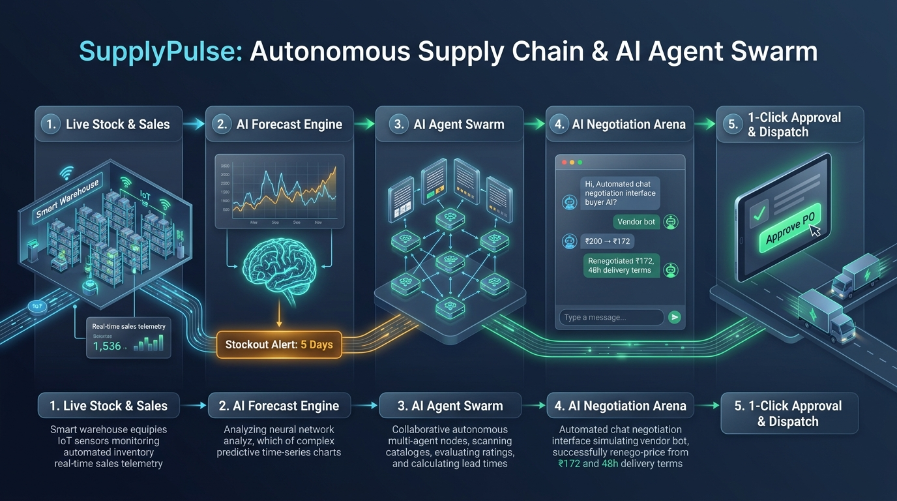

# ⚡ SupplyPulse: Autonomous Supply Chain & Consumer Rights Defense Platform



**SupplyPulse** is an enterprise-grade AI operations platform combining **Classical Machine Learning** (time-series demand forecasting & defect classification) with **Agentic Multi-Agent Swarms** (autonomous B2B price bargaining and consumer warranty dispute resolution).

---

## 🎯 What Problem Does It Solve?

### 1. B2B Enterprise Problem (Stockout Prevention & Procurement)
Quick-commerce and retail supply chains (Blinkit, Zepto, Amazon, Walmart) lose billions to sudden demand spikes and manual negotiation delays. SupplyPulse:
* Forecasts inventory stockouts **7 to 14 days in advance** using Machine Learning.
* Automatically discovers and ranks enterprise suppliers.
* Dispatches an **Autonomous Negotiator Agent** that conducts multi-turn bargaining for bulk discounts and guaranteed 48-hour delivery SLAs.
* Generates audit-ready electronic Purchase Orders (POs) with 1-click human approval.

### 2. Consumer Problem (Customer Support Stonewalling & Warranty Defense)
Customer service chatbots (e-commerce platforms, electronics manufacturers) deflect valid claims with generic excuses: *"7-day return window expired"*, *"Visit service center 40 km away"*. SupplyPulse:
* Ingests damage photos and invoices via Computer Vision & Forensic Analysis.
* Analyzes the **Consumer Protection Act, 2019 (Sections 2(47), 84, 85)** and statutory warranty law.
* Dispatches a **Customer AI Advocate Bot** that fights customer service chatbots in multi-turn legal negotiation, forcing full 100% refunds, doorstep RMA pickups, or replacements.

---

## 🏗️ System Architecture

```mermaid
flowchart TD
    subgraph B2B ["🏢 B2B Supply Chain Autopilot"]
        SalesStream["Live Sales & Telemetry"] --> MLForecast["ML Demand Forecaster (HistGradientBoosting)"]
        MLForecast --> Sentinel["Agent 1: Inventory Sentinel (Dynamic ROP Risk)"]
        Sentinel -- "Critical Stockout Alert" --> Discovery["Agent 2: Supplier Discovery & Utility Ranker"]
        Discovery --> Negotiator["Agent 3: Autonomous Procurement Negotiator"]
        Negotiator <--> VendorBot["Vendor Bot API (Multi-Turn Bargaining)"]
        Negotiator --> POGen["Agent 4: Purchase Order Generator"]
        POGen --> WarehouseRestock["Dock Delivery & Warehouse Restock"]
    end

    subgraph Consumer ["🛡️ Customer AI Advocate"]
        CustomerEvidence["Damage Photo + Invoice Upload"] --> Forensics["Defect Forensics & Statute Matcher"]
        Forensics --> Advocate["Agent 5: Customer AI Advocate Bot"]
        Advocate <--> CorporateSupport["Corporate Support Chatbot"]
        Advocate -- "Cites CPA 2019 Sec 84 & NCH Escalation" --> Settlement["100% Full Refund / Doorstep Replacement"]
    end
```



---

## 🧠 Core AI/ML Components & Mathematics

### 1. Dynamic Reorder Point (ROP) Formula
The Inventory Sentinel continuously computes the mathematically optimal reorder threshold:

$$\text{ROP} = (\text{Projected Daily Demand} \times \text{Supplier Lead Time}) + \text{Safety Stock}$$

When:
$$\text{Current Stock} \le \text{ROP}$$
An autonomous replenishment mission is immediately spawned.

### 2. Multi-Criteria Vendor Utility Scoring
Suppliers are scored using a weighted multi-attribute utility model:

$$\text{Utility} = 0.40 \times \text{Cost Efficiency} + 0.35 \times \text{Reliability Score} + 0.25 \times \text{Speed Score}$$

### 3. Forensic Defect Classification
* **Transit Damage:** Packaging breach / crush occurring prior to custody handover (CPA 2019 Section 2(47)).
* **Latent Hardware Defect:** Inherent component failure manifesting during warranty period (CPA 2019 Section 84).
* **Deficiency in Service:** Unreasonable platform delay or failure to provide local service (CPA 2019 Section 85).

---

## 📂 Project Directory Structure

```
supplypulse/
├── __init__.py
├── README.md                           # Documentation & architecture guide
├── requirements.txt                    # Python dependencies
├── app.py                              # Streamlit interactive dashboard
├── test_pipeline.py                    # End-to-end integration test suite
├── data/
│   ├── inventory.json                  # Live warehouse stock telemetry
│   ├── suppliers.json                  # Enterprise supplier catalog & discount tiers
│   └── warranty_database.json          # Statutory legal frameworks & dispute precedents
├── models/
│   ├── __init__.py
│   ├── forecaster.py                   # ML demand forecasting & ROP engine
│   └── damage_analyzer.py              # Defect forensics & consumer law analyzer
└── agents/
    ├── __init__.py
    ├── inventory_sentinel.py           # Agent 1: Real-time stock monitor
    ├── supplier_discovery.py           # Agent 2: Vendor utility scorer
    ├── negotiator.py                   # Agent 3: B2B bargaining agent
    ├── po_generator.py                 # Agent 4: PO & settlement generator
    ├── consumer_advocate.py            # Agent 5: Customer AI advocate bot
    └── orchestrator.py                 # Multi-Agent Swarm Orchestrator
```

---

## 🚀 Quickstart & How to Run

### 1. Install Dependencies
```bash
pip install -r supplypulse/requirements.txt
```

### 2. Run Automated Integration Tests
Verify both B2B and Consumer Advocacy pipelines end-to-end:
```bash
python supplypulse/test_pipeline.py
```

### 3. Launch the Interactive Dashboard
Launch the modern Streamlit command center:
```bash
streamlit run supplypulse/app.py
```
Open `http://localhost:8501` in your browser.

---

## 🎤 Interview Talking Points

* **Not Just Another Chatbot:** Combines tabular Machine Learning (`HistGradientBoostingRegressor`) with multi-agent game-theoretic negotiation protocols.
* **Dual Enterprise & Consumer Impact:** Demonstrates understanding of enterprise ERP logistics (landed costs, liquidated damages, GST compliance) as well as consumer law (Consumer Protection Act 2019, statutory RMA rights).
* **Zero External API Cost Required:** Features a modular architecture capable of running fully offline with local heuristics or hooking into live LLMs (Gemini / Claude / Llama 3 via Groq).
